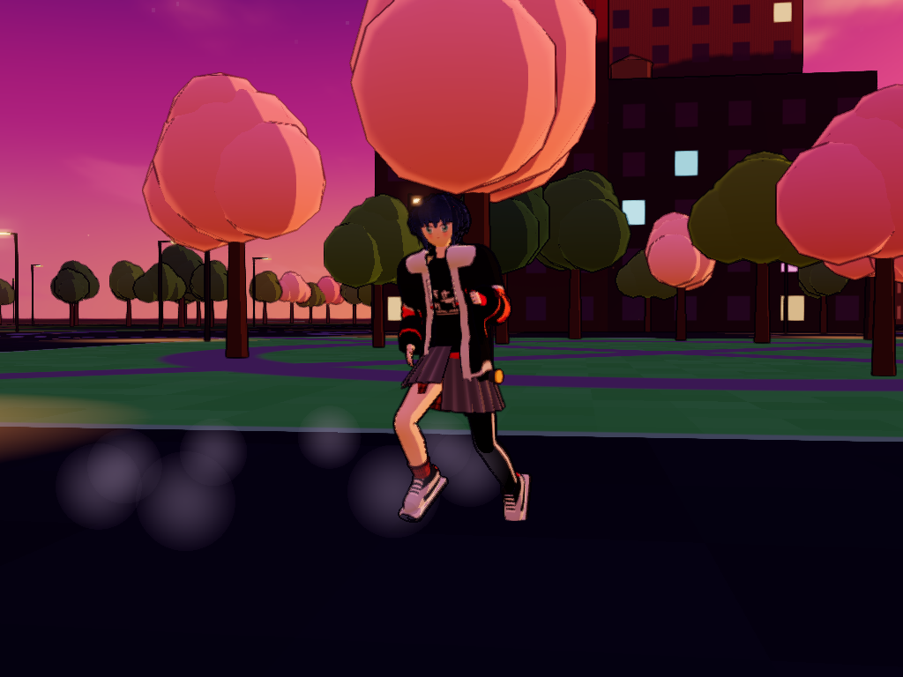
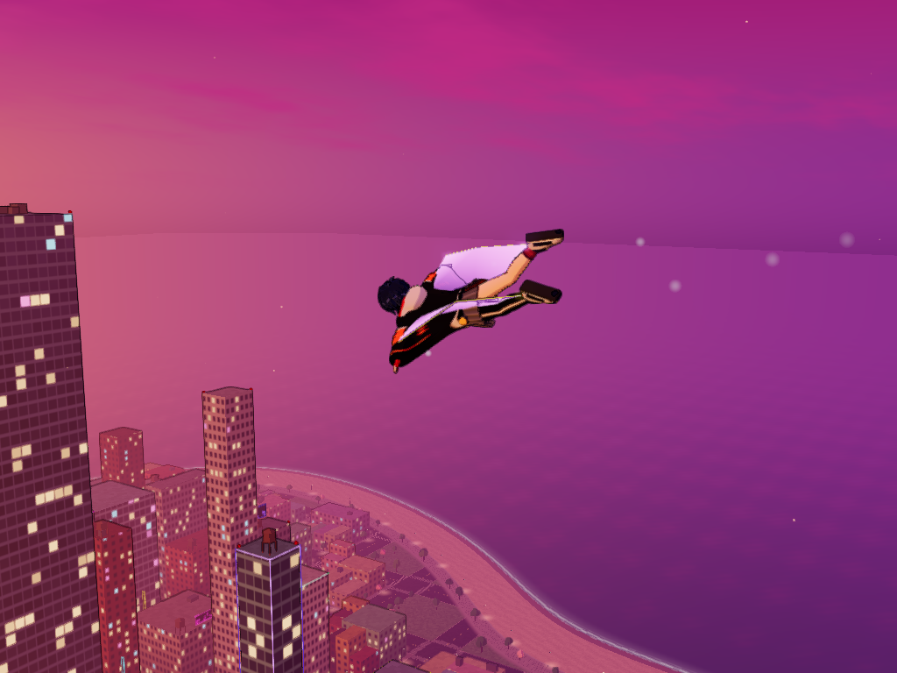
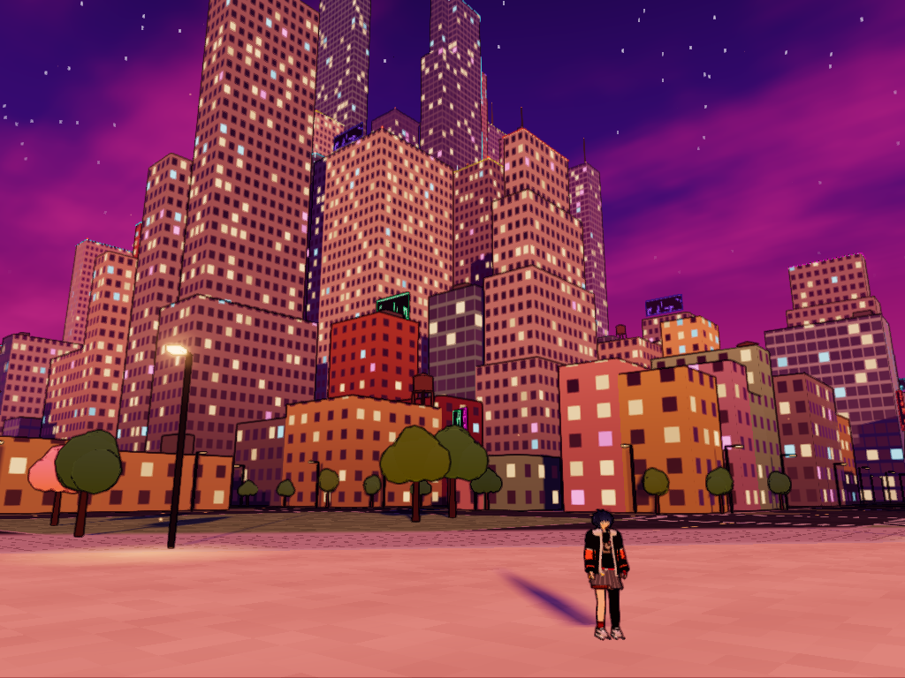

# Enterhaken – Gameplay-Prototyp

Third-Person-Prototyp: Mit zwei Enterhaken durch eine dichte, prozedural generierte, dystopische
Hochhausstadt auf einer Insel in Abendstimmung schwingen, gleiten und an Wänden entlangrennen.
Spielfigur ist eine Anime-Figur namens Kaia. Kein Level, kein Ziel – nur eine Sandbox
zum Testen von Gefühl und Physik.

**Aktuelle Version: 0.4.0** · Änderungen siehe [CHANGELOG.md](CHANGELOG.md)

| | |
|---|---|
|  |  |
|  |  |
|  |  |
|  |  |
|  |  |
|  |  |

## Starten

Doppelklick auf **`start.bat`** – startet einen kleinen lokalen Server (PowerShell, nichts zu installieren)
und öffnet `http://localhost:8080/` im Browser. Internet wird benötigt (Three.js kommt vom CDN).
Beim Klick ins Spiel wechselt der Browser ins Vollbild (mit Tastatursperre in Chrome/Edge, damit
Strg-Kombinationen wie Strg+W den Tab nicht schließen). Abschaltbar im Tuning-Menü unter „Welt“.

Alternativ: `powershell -ExecutionPolicy Bypass -File serve.ps1 -Open`

## Steuerung

| Eingabe | Aktion |
|---|---|
| Maus | Umsehen / zielen |
| Linke / rechte Maustaste halten | Linken / rechten Haken abschießen, solange gehalten eingehakt |
| W A S D | Gehen · am Seil: Schwung pumpen · im Wallrun: W + Blick lenkt (hoch schauen = hochlaufen) |
| Shift | Am Boden halten: **sprinten** · in der Luft antippen: **Dash** · in der Luft halten: **Gas-Schub** |
| Leertaste | Springen, im Wallrun: Wandsprung mit Salto · am Seil **halten** = Winde zieht zum Anker |
| Strg (antippen) | **Gleiter** in der Luft an/aus – Blick lenkt, W = Sturzflug, S = abfangen |
| S im Wallrun | Von der Wand lösen |
| R / T / C | Reset / Zeitlupe / Schulter wechseln |
| G / H / P | Tuning-Menü / Hilfe / Screenshot (landet in `screenshots/`) |
| Esc | Pause |

## Mechaniken

- **Gehen & Sprinten:** Gehen (2,2 m/s), über Joggen bis Sprint (9 m/s). Laufrichtung und Körperausrichtung sind
  getrennt: Kaia dreht sich in die neue Richtung, statt den ganzen Körper zu kippen; je schneller, desto weiter der
  Bogen. Bei scharfen Richtungswechseln aus vollem Lauf bremst sie ab, dreht sich um und stößt sich in die neue
  Richtung ab (Wende). Beim Loslassen aus dem Sprint gibt es einen Abbremsschritt.
- **Dash & Gas-Schub:** Shift in der Luft antippen = kurzer Gasstoß in Blickrichtung (mit Abklingzeit); Shift halten =
  dauerhafter Gas-Schub wie in v0.2.0. Beides kostet Gas, das sich ohne Schub wieder auffüllt.
- **Gleiter:** leuchtende Flügelmembranen zwischen Armen und Beinen mit echtem Flugmodell: Auftrieb senkrecht zur
  Flugbahn abhängig vom Anstellwinkel, Luftwiderstand, Strömungsabriss bei zu steilem Anstellen. Der Blick lenkt:
  Kurven fliegt Kaia mit Querneigung, Sturzflug baut Tempo auf, Abfangen setzt es wieder in Höhe um.
  Landen, Wallrun oder Einhaken beenden das Gleiten.
- **Zielen ist Pflicht:** Der Haken fliegt genau dorthin, wo das Fadenkreuz ein Gebäude trifft
  (Grün = in Reichweite 140 m, Rot = zu weit).
- **Seilphysik:** Punktmasse mit Schwerkraft und Luftwiderstand, leicht elastisches Seil (Feder + Dämpfer, harte
  Grenze bei 1,5 m Dehnung), sanftes Einholen, Steuerung quer zum Seil, kleiner Schwung beim Lösen, Seile wickeln
  sich um Kanten.
- **Wallrun:** Prallt man in der Luft gegen eine Fassade, startet automatisch ein Wallrun; Wandsprung mit Salto.

## Welt

- **Natürliche Insel** (ca. 800 m Durchmesser) mit unregelmäßiger Küstenlinie, Sandstrand rundherum, Uferpromenade
  mit Laternen und einem Meer, das den Abendhimmel spiegelt, in der Sonne glitzert und am Ufer schäumt.
- **Stadtviertel:** Hochhaus-Zentrum, Midtown, Wohnviertel und Uferbebauung mit eigenen Farbpaletten (Glas, Büro,
  Backstein, warme und pastellige Fassaden).
- **Gebäudeformen:** Türme, gestufte Hochhäuser, Zwillingstürme mit Skybridge, Turmspitzen, Scheibenhäuser,
  L-Formen, Reihenhäuser und Blöcke mit Innenhof; dazu Dachaufbauten, Wassertürme und Antennen.
- **Grün:** Zentralpark mit Teich, kleinere Parks und Plätze, Straßenbäume und Kirschbäume.

## Figur & Animationen

- Kaia ist aus **Signed Distance Fields** modelliert (`src/sdf.js`) und per Marching Cubes in weiche, runde Meshes
  umgewandelt: Jacke als Stoffschale mit Falten, Kapuze, Ärmeln und Bündchen, Haare aus verschmolzenen Strähnen
  (Pony, Gesichtssträhnen, abstehende Spitzen, Zopf), Hände mit Fingern, klobige Sneaker.
- Dunkelblaue, wuschelige Kurzhaare mit roter Spange, türkise Augen, übergroße schwarze Jacke mit hellgrauer Kapuze
  und orangen Ärmelfeldern, Print-Shirt, roter Gürtel, grauer asymmetrischer Faltenrock mit Karo-Lage, links
  Overknee-Strumpf, rechts kurze Socke, roter Halbfinger-Handschuh. Farben zentral in `LOOK` (`src/character.js`).
- Arme, Beine, Oberkörper, Jacke und Haare sind **gehäutet** (SkinnedMesh) – weiche Gelenke statt Einzelteile.
- Keyframe-Clips (`src/animations.js`), per Catmull-Rom-Spline geglättet, mit eigener Gewichtssteuerung überblendet:
  Idle, Gehen, Joggen und Sprint (phasensynchron gemischt, Schrittlänge = Tempo × Zyklusdauer, dadurch keine
  rutschenden Füße), Wende, Abbremsen, Sprung, Steigen, Gipfel, Fallen, schnelles Fallen, Landung,
  Superhelden-Landung, Rutschen, Schwingen, Winde, Gas-Schub, Dash, Gleiten, Wallrun, Salto.
- Prozedurale Ebene: Oberkörper und Kopf drehen sich leicht in die Kurve voraus, Kopf schaut in Zielrichtung (nur am
  Boden), nachschwingende Haare, flatternder Jackensaum, Rockhälften folgen den Beinen.

## Look

- Abendhimmel in Orange/Lila mit Wolken, Sternen und tief stehender Sonne; Dunst folgt der Himmelsfarbe, Smog in den
  Straßenschluchten.
- Cel-Shading, Tuschelinien aus dem Tiefenpuffer, Bloom, Outline-Hülle um die Figur.
- Neon-Schilder, Werbetafeln, Leuchtkanten, Flugwarnlichter, Straßenlaternen mit Lichtkegeln, aufsteigende Funken.

## Tuning

Alle Werte stehen in `src/config.js` und lassen sich im Spiel mit **G** live verändern – Physik, Bewegung
(Geh-/Sprinttempo, Trägheit, Drehen, Wende), Dash & Gas-Schub, Gleiter (Anstellwinkel, Auftrieb, Widerstand,
Querneigung), Seil, Gas, Wallrun, Kamera, Grafik und Stadt-Seed.

## Aufbau

| Datei | Inhalt |
|---|---|
| `src/main.js` | Spielschleife (feste 120-Hz-Physik, interpoliertes Rendering), Zielen, Events, Effekte |
| `src/player.js` | Gehen/Sprinten/Wende, Dash, Gas-Schub, Gleiter-Aerodynamik, elastische Seile, Kollision, Wallrun |
| `src/character.js` | Figurenmodell, Skinning, Gleiter-Flügel, Animations-Gewichtung, prozedurale Ebene |
| `src/sdf.js` | Distanzfelder (Kegel, Ellipsoide, Tori, weiche Vereinigung), Marching Cubes, Bemalen, Skinning-Gewichte |
| `src/charGeo.js` | Geometrie: gehäutete Röhren, Faltenrock, Kopf |
| `src/animations.js` | Posen und Keyframe-Clips |
| `src/hooks.js` | Haken-Projektil, Anker, Seil-Darstellung |
| `src/city.js` | Insel- und Stadtgenerator, Viertel, Gebäudeformen, Parks, Bäume, Raster-Index, Raycasts, Fassaden-Shader |
| `src/world.js`, `src/palette.js` | Himmel, Dunst, Licht, Boden (Straßen, Parks, Strand), Meer, Farbpalette |
| `src/post.js`, `src/toon.js` | Tuschelinien, Bloom, Tonemapping, FXAA · Toon- und Outline-Materialien |
| `src/camera.js` | Schulterkamera mit Kollision, Glättung, Neigung |
| `src/effects.js`, `hud.js`, `audio.js`, `tuning.js`, `input.js` | Partikel/Funken/Speedlines, HUD, Sound, Tuning, Eingabe |

Debug: `http://localhost:8080/?debug` läuft ohne Pointer-Lock und Vollbild; `window.game` ist in der Konsole verfügbar.
