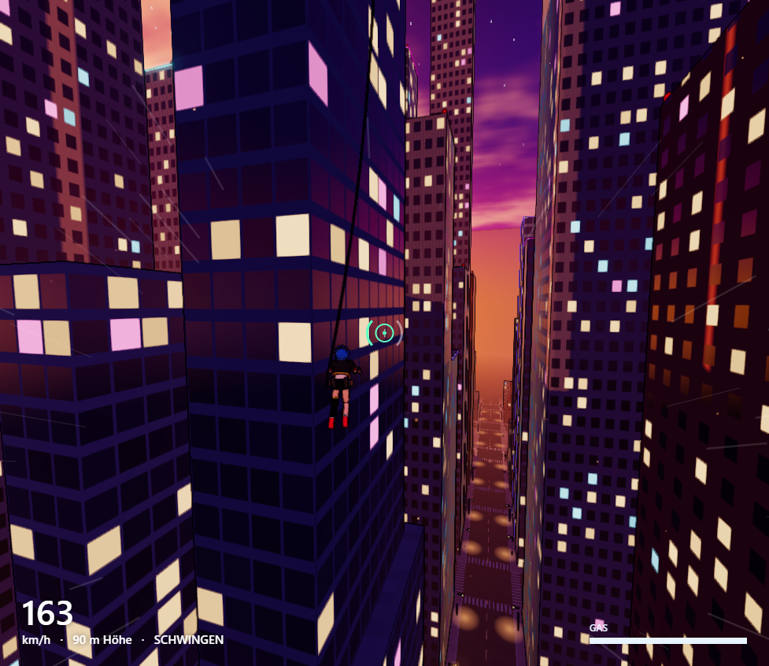
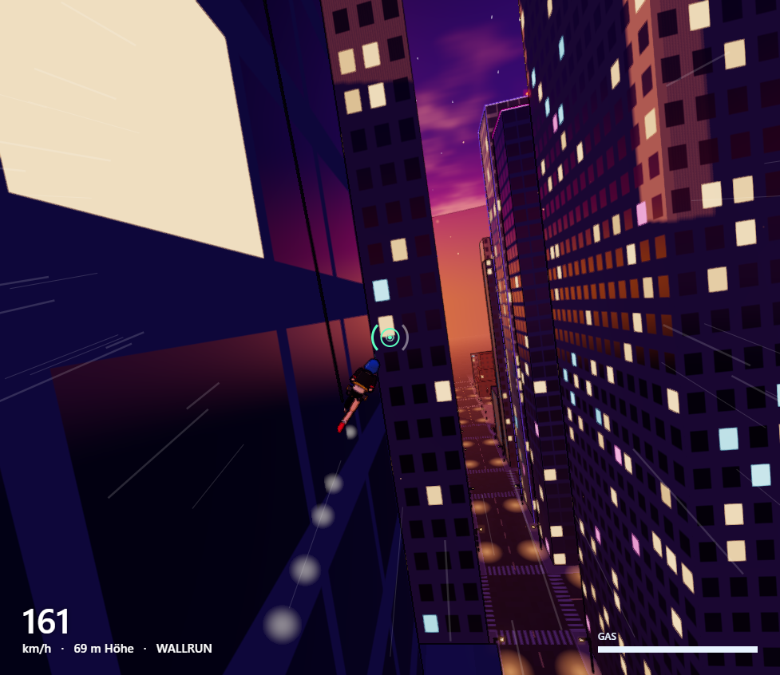
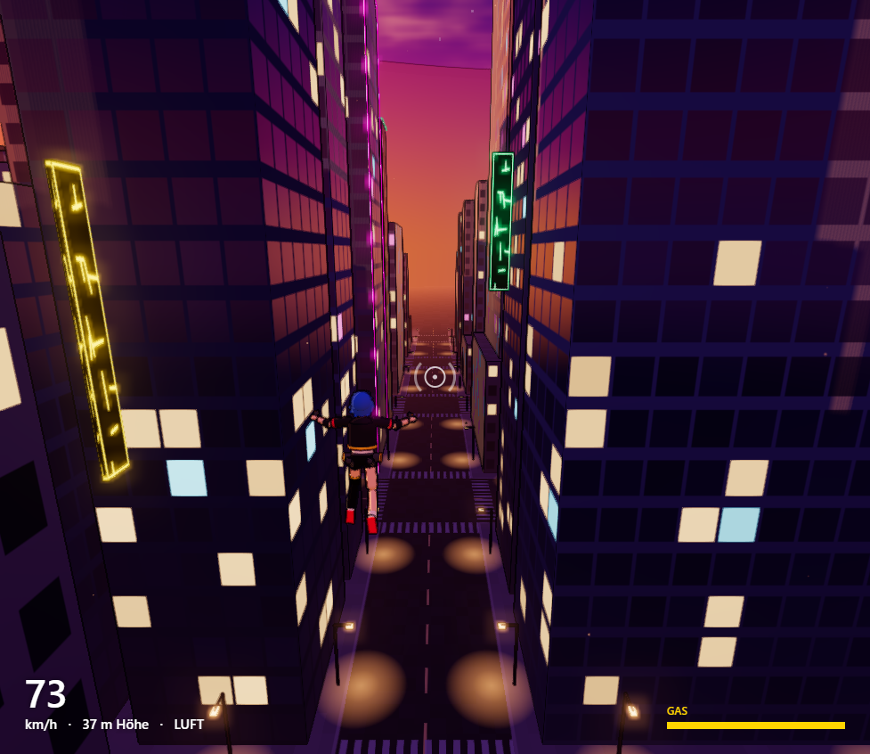
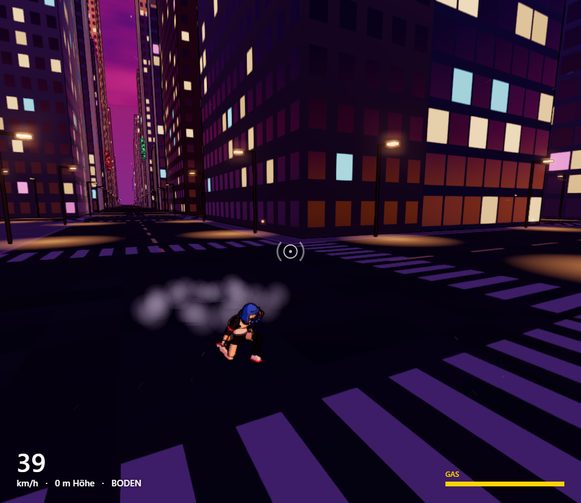
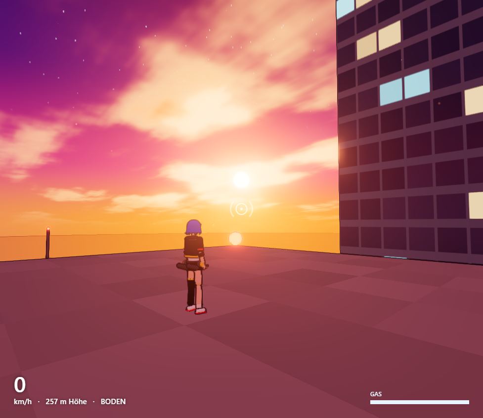
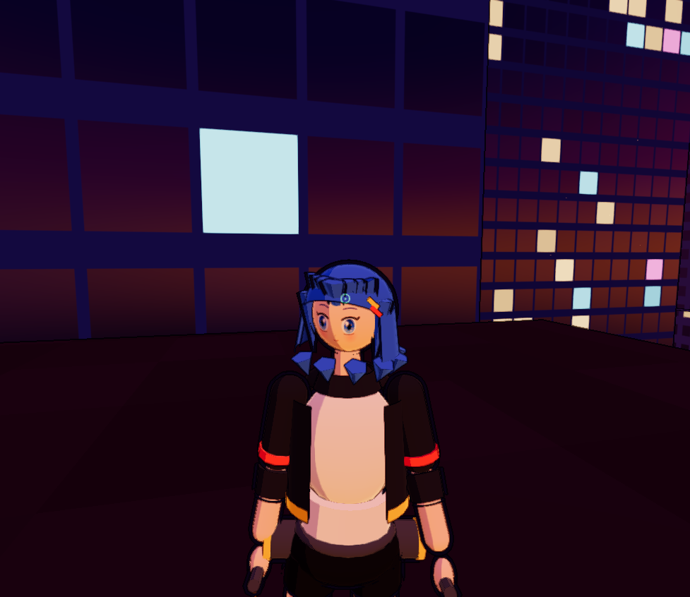

# Enterhaken – Gameplay-Prototyp

Third-Person-Prototyp: Mit zwei Enterhaken durch eine dichte, prozedural
generierte, dystopische Hochhausstadt in Abendstimmung schwingen. Spielfigur ist eine Anime-Figur
namens Kaia. Kein Level, kein Ziel – nur eine Sandbox zum Testen von Gefühl und Physik.

**Aktuelle Version: 0.2.0** · Änderungen siehe [CHANGELOG.md](CHANGELOG.md)

| | |
|---|---|
|  |  |
|  |  |
|  |  |

## Starten

Doppelklick auf **`start.bat`** – startet einen kleinen lokalen Server (PowerShell, nichts zu installieren)
und öffnet `http://localhost:8080/` im Browser. Internet wird benötigt (Three.js kommt vom CDN).

Alternativ: `powershell -ExecutionPolicy Bypass -File serve.ps1 -Open`

## Steuerung

| Eingabe | Aktion |
|---|---|
| Maus | Umsehen / zielen |
| Linke / rechte Maustaste halten | Linken / rechten Haken abschießen, solange gehalten eingehakt |
| Leertaste | Springen, im Wallrun: Wandsprung (mit Salto) · **halten** = Seilwinde zieht zum Anker |
| Shift | Gas-Schub in Blickrichtung |
| W A S D | Laufen · am Seil: Schwung pumpen · im Wallrun: W + Blick lenkt (hoch schauen = hochlaufen) |
| S im Wallrun | Von der Wand lösen |
| R / T / C | Reset / Zeitlupe / Schulter wechseln |
| G / H / P | Tuning-Menü / Hilfe / Screenshot (landet in `screenshots/`) |
| Esc | Pause |

## Mechaniken

- **Zielen ist Pflicht:** Der Haken fliegt genau dorthin, wo das Fadenkreuz ein Gebäude trifft.
  Grün = in Reichweite (140 m), Rot = zu weit, Weiß = kein Ziel.
- **Seilphysik:** Punktmasse mit Schwerkraft und Luftwiderstand. Das Seil ist leicht elastisch
  (Feder + Dämpfer über der Ruhelänge, harte Grenze bei 1,5 m Dehnung) – Straffen federt weich ab statt zu rucken.
  Die Winde holt lockeres Seil sanft ein, WASD wirkt nur quer zum Seil (Schwung pumpen), und beim Lösen eines
  gespannten Seils gibt es einen kleinen Schwung in Flugrichtung, damit sich Schwünge flüssig verketten lassen.
  Seile wickeln sich um Gebäudekanten.
- **Wallrun:** Prallt man in der Luft gegen eine Fassade, startet automatisch ein Wallrun. Ein Teil der
  Aufprallgeschwindigkeit wird in Laufrichtung umgelenkt (frontal = nach oben). Wandsprung mit Salto.
- **Gas:** Schub und Winde verbrauchen Gas, das sich regeneriert (am Boden schneller).

## Look

- Abendhimmel in Orange/Lila mit Wolken, Sternen und tief stehender Sonne; Dunst, dessen Farbe dem Himmel
  in Blickrichtung folgt, plus Smog in den Straßenschluchten; eine riesige Mauer am Horizont.
- Cel-Shading (Toon-Materialien), Tuschelinien aus dem Tiefenpuffer, Bloom, Outline-Hülle um die Figur.
- Fenster leuchten warm oder neon-farbig bzw. spiegeln den Himmel; Neon-Schilder, Werbetafeln, Leuchtkanten,
  blinkende Flugwarnlichter, Straßenlaternen mit Lichtkegeln, aufsteigende Funken.

## Figur & Animationen

Die Figur ist prozedural aus Grundkörpern gebaut (Farben in `LOOK` in `src/character.js`).
Animationen sind echte Keyframe-Clips (`src/animations.js`), per Catmull-Rom-Spline geglättet und über den
Three.js-`AnimationMixer` mit Überblendungen abgespielt: Idle, Laufen (Takt passt sich dem Tempo an), Sprung,
Steigen, Fallen, Landung, Superhelden-Landung, Rutschen, Schwingen, Winde, Gas-Schub, Wallrun, Salto.
Darüber liegt eine prozedurale Ebene: Der Kopf schaut in Zielrichtung, die Haare schwingen nach.

## Tuning

Alle Werte stehen in `src/config.js` und lassen sich im Spiel mit **G** live verändern – Physik, Seil
(Steifigkeit, Dämpfung, Einholen, Schwung beim Lösen), Gas, Wallrun, Kamera, Grafik (Tuschelinien, Bloom,
Belichtung, Sättigung) und Stadt-Seed.

## Aufbau

| Datei | Inhalt |
|---|---|
| `src/main.js` | Spielschleife (feste 120-Hz-Physik, interpoliertes Rendering), Zielen, Events |
| `src/player.js` | Bewegung, elastische Seile, Kollision, Wallrun |
| `src/hooks.js` | Haken-Projektil, Anker, Seil-Darstellung |
| `src/city.js` | Stadtgenerator, Raster-Index, Raycasts, Fassaden-Shader, Neon-Deko |
| `src/world.js`, `src/palette.js` | Himmel, Dunst, Licht, Straßen, Laternen, Mauer, Farbpalette |
| `src/post.js`, `src/toon.js` | Tuschelinien, Bloom, Tonemapping, FXAA · Toon- und Outline-Materialien |
| `src/character.js`, `src/animations.js` | Figur, Gesichtstextur, Animations-Zustandsmaschine, Keyframe-Clips |
| `src/camera.js` | Schulterkamera mit Kollision, geglättete Verfolgung, Neigung in Kurven und beim Wallrun |
| `src/effects.js`, `hud.js`, `audio.js`, `tuning.js`, `input.js` | Partikel/Funken/Speedlines, HUD, Sound, Tuning-Menü, Eingabe |

Debug: `http://localhost:8080/?debug` läuft ohne Pointer-Lock; `window.game` ist in der Konsole verfügbar.
