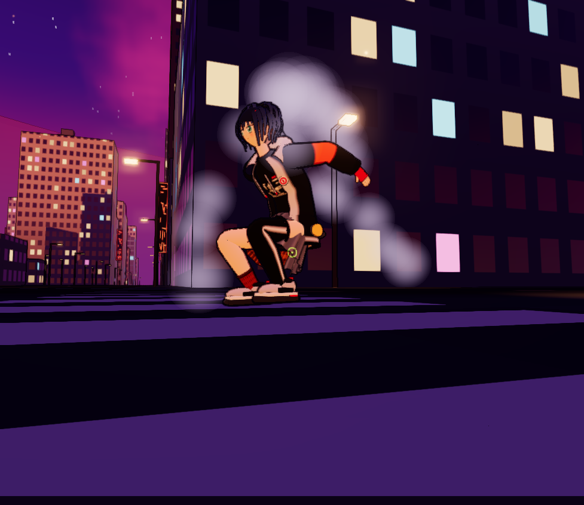
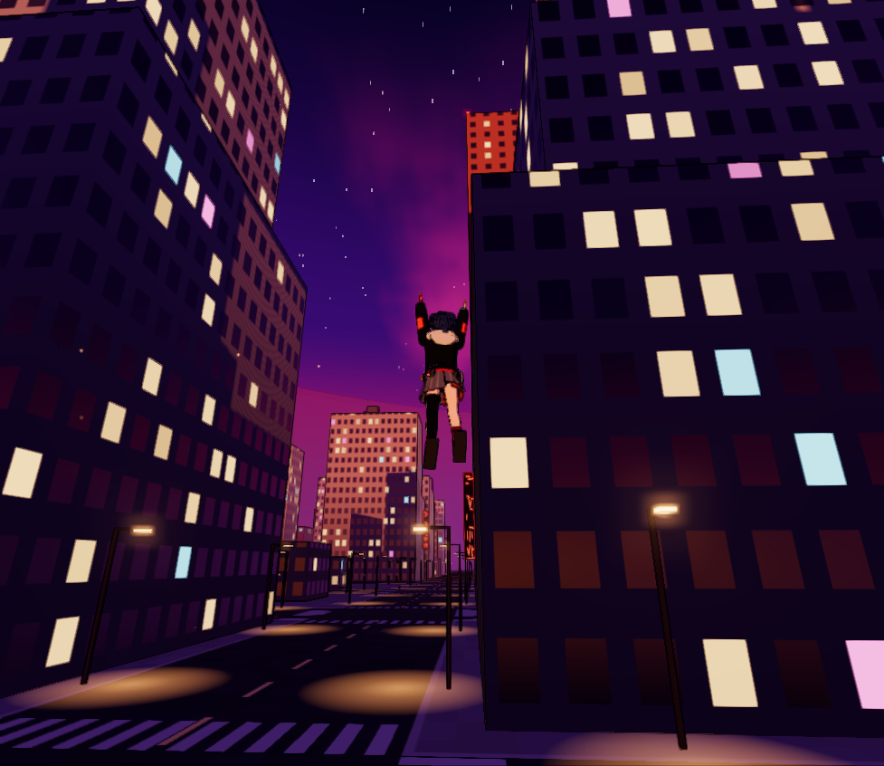
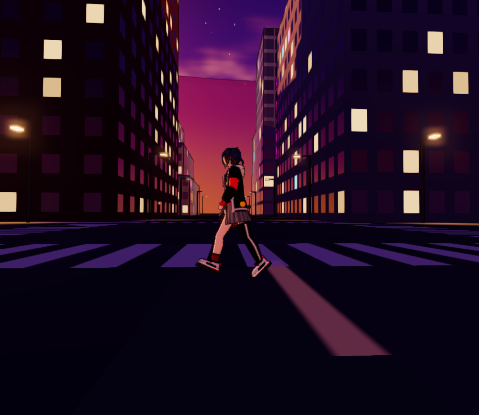

# Enterhaken – Gameplay-Prototyp

Third-Person-Prototyp: Mit zwei Enterhaken durch eine dichte, prozedural
generierte, dystopische Hochhausstadt in Abendstimmung schwingen, gleiten und an Wänden entlangrennen.
Spielfigur ist eine Anime-Figur namens Kaia. Kein Level, kein Ziel – nur eine Sandbox
zum Testen von Gefühl und Physik.

**Aktuelle Version: 0.3.0** · Änderungen siehe [CHANGELOG.md](CHANGELOG.md)

| | |
|---|---|
|  |  |
|  |  |
|  |  |
|  |  |

## Starten

Doppelklick auf **`start.bat`** – startet einen kleinen lokalen Server (PowerShell, nichts zu installieren)
und öffnet `http://localhost:8080/` im Browser. Internet wird benötigt (Three.js kommt vom CDN).
Beim Klick ins Spiel wechselt der Browser ins Vollbild (mit Tastatursperre in Chrome/Edge, damit
Strg-Kombinationen wie Strg+W den Tab nicht schließen). Abschaltbar im Tuning-Menü unter „Welt“.

Alternativ: `powershell -ExecutionPolicy Bypass -File serve.ps1 -Open`

## Steuerung

| Eingabe | Aktion |
|---|---|
| Maus | Umsehen / zielen |
| Linke / rechte Maustaste halten | Linken / rechten Haken abschießen, solange gehalten eingehakt |
| W A S D | Gehen · am Seil: Schwung pumpen · im Wallrun: W + Blick lenkt (hoch schauen = hochlaufen) |
| Shift | Am Boden: **sprinten** (halten) · in der Luft: **Dash** in Blickrichtung |
| Leertaste | Springen, im Wallrun: Wandsprung mit Salto · am Seil **halten** = Winde zieht zum Anker |
| Leertaste im Stand halten | **Sprung aufladen**, loslassen = Supersprung senkrecht nach oben (bis ca. 25 m) |
| Strg (antippen) | **Gleiter** in der Luft an/aus – Blick lenkt, W = Sturzflug, S = abfangen |
| S im Wallrun | Von der Wand lösen |
| R / T / C | Reset / Zeitlupe / Schulter wechseln |
| G / H / P | Tuning-Menü / Hilfe / Screenshot (landet in `screenshots/`) |
| Esc | Pause |

## Mechaniken

- **Gehen & Sprinten mit Gewicht:** Die Figur bewegt sich entlang ihrer Blickrichtung und dreht mit begrenzter
  Geschwindigkeit – beim Sprinten in weiten Bögen. Träges Beschleunigen, kräftiges Abbremsen mit Stopp-Animation,
  Vorlage beim Anlaufen, Neigung in Kurven, Kamera-Wippen und Schrittgeräusche im Takt.
- **Aufladesprung:** im Stand Leertaste halten – die Figur geht tief in die Knie, Staub sammelt sich, die Kamera
  zoomt heran. Loslassen schleudert sie senkrecht nach oben.
- **Dash:** Shift in der Luft gibt einen kurzen Gasstoß in Blickrichtung (kurz kaum Schwerkraft), kostet Gas.
  Funktioniert auch aus dem Wallrun und im Gleitflug.
- **Gleiter:** leuchtende Flügelmembranen zwischen Armen und Beinen. Energiemodell entlang der
  Flugbahn: Sinken beschleunigt, Steigen und Luftwiderstand bremsen, bei zu wenig Tempo kippt die Nase nach unten.
  Landen, Wallrun oder Einhaken beenden das Gleiten.
- **Zielen ist Pflicht:** Der Haken fliegt genau dorthin, wo das Fadenkreuz ein Gebäude trifft
  (Grün = in Reichweite 140 m, Rot = zu weit).
- **Seilphysik:** Punktmasse mit Schwerkraft und Luftwiderstand, leicht elastisches Seil (Feder + Dämpfer, harte
  Grenze bei 1,5 m Dehnung), sanftes Einholen, Steuerung quer zum Seil, kleiner Schwung beim Lösen, Seile wickeln
  sich um Kanten.
- **Wallrun:** Prallt man in der Luft gegen eine Fassade, startet automatisch ein Wallrun; Wandsprung mit Salto.

## Figur & Animationen

- Kaia: dunkelblaue, wuschelige Kurzhaare aus rund 60 verjüngten Strähnen (mit Pony, Zopf und roter
  Spange), türkise Augen, übergroße schwarze Jacke mit hellgrauer Kapuze und orangen Ärmelfeldern, Abzeichen,
  Print-Shirt, roter Gürtel mit Anhänger, grauer asymmetrischer Faltenrock mit Karo-Lage, links Overknee-Strumpf mit
  weißem Streifen und Rüschenrand, rechts kurze rostbraune Socke, roter Halbfinger-Handschuh, türkises Armband,
  klobige Sneaker. Farben zentral in `LOOK` (`src/character.js`).
- Arme, Beine, Oberkörper und Jacke sind **gehäutet** (SkinnedMesh), dadurch biegen sich Knie, Ellbogen und Rumpf weich.
- Keyframe-Clips (`src/animations.js`), per Catmull-Rom-Spline geglättet, mit eigener Gewichtssteuerung überblendet:
  Idle mit Gewichtsverlagerung, Gehen und Sprint (phasensynchron gemischt, Schrittlänge passt zum Tempo), Abbremsen,
  Aufladen, Supersprung, Sprung, Steigen, Gipfel, Fallen, schnelles Fallen, Landung, Superhelden-Landung, Rutschen,
  Schwingen, Winde, Dash, Gleiten, Wallrun, Salto.
- Prozedurale Ebene: Lehnen beim Beschleunigen und in Kurven, Kopf schaut in Zielrichtung (nur am Boden),
  nachschwingende Haare, flatternder Jackensaum, Rockhälften folgen den Beinen.

## Look

- Abendhimmel in Orange/Lila mit Wolken, Sternen und tief stehender Sonne; Dunst folgt der Himmelsfarbe, Smog in den
  Straßenschluchten, riesige Mauer am Horizont.
- Cel-Shading, Tuschelinien aus dem Tiefenpuffer, Bloom, Outline-Hülle um die Figur.
- Neon-Schilder, Werbetafeln, Leuchtkanten, Flugwarnlichter, Straßenlaternen mit Lichtkegeln, aufsteigende Funken.

## Tuning

Alle Werte stehen in `src/config.js` und lassen sich im Spiel mit **G** live verändern – Physik, Bewegung
(Geh-/Sprinttempo, Trägheit, Drehen, Aufladesprung), Dash, Gleiter, Seil, Gas, Wallrun, Kamera, Grafik und Stadt-Seed.

## Aufbau

| Datei | Inhalt |
|---|---|
| `src/main.js` | Spielschleife (feste 120-Hz-Physik, interpoliertes Rendering), Zielen, Events, Effekte |
| `src/player.js` | Gehen/Sprinten, Aufladesprung, Dash, Gleiter, elastische Seile, Kollision, Wallrun |
| `src/character.js` | Figurenmodell, Skinning, Gleiter-Flügel, Animations-Gewichtung, prozedurale Ebene |
| `src/charGeo.js` | Geometrie: gehäutete Röhren, Haarsträhnen, Faltenrock, Kopf |
| `src/animations.js` | Posen und Keyframe-Clips |
| `src/hooks.js` | Haken-Projektil, Anker, Seil-Darstellung |
| `src/city.js` | Stadtgenerator, Raster-Index, Raycasts, Fassaden-Shader, Neon-Deko |
| `src/world.js`, `src/palette.js` | Himmel, Dunst, Licht, Straßen, Laternen, Mauer, Farbpalette |
| `src/post.js`, `src/toon.js` | Tuschelinien, Bloom, Tonemapping, FXAA · Toon- und Outline-Materialien |
| `src/camera.js` | Schulterkamera mit Kollision, Glättung, Wippen, Neigung |
| `src/effects.js`, `hud.js`, `audio.js`, `tuning.js`, `input.js` | Partikel/Funken/Speedlines, HUD, Sound, Tuning, Eingabe |

Debug: `http://localhost:8080/?debug` läuft ohne Pointer-Lock und Vollbild; `window.game` ist in der Konsole verfügbar.
